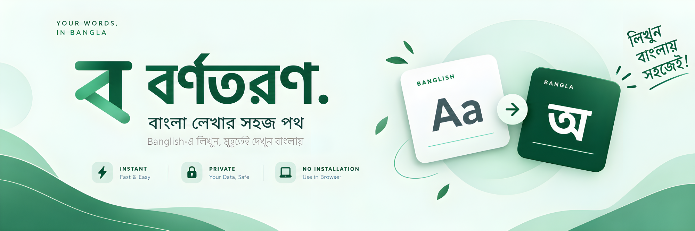

<div align="center">

<p align="center">
  
</p>

# [বর্ণতরণ](https://bornotoron.vercel.app) · Bornotoron

### বাংলা লেখার সহজ পথ

বাংলিশে লিখুন, মুহূর্তেই দেখুন বাংলায়


**ভাষা:** [English](README.md) | বাংলা

**৪৯০০+ বানানের এন্ট্রি। কোনো ফ্রেমওয়ার্ক নেই। আপনার লেখা আপনার কাছেই থাকে।**

</div>


## 📌 সূচিপত্র

- [📑 পরিচিতি](#overview)
- [💡 কেন Bornotoron?](#why-bornotoron)
- [✨ প্রধান বৈশিষ্ট্য](#key-features)
- [🛠️ টেক স্ট্যাক](#built-with)
- [🌗 থিমিং ও ব্র্যান্ড](#theming)
- [🚀 শুরু করা](#getting-started)
- [📁 প্রজেক্ট স্ট্রাকচার](#project-structure)
- [🧠 ইঞ্জিন যেভাবে কাজ করে](#engine)
- [⌨️ ফোনেটিক কুইক রেফারেন্স](#phonetic-reference)
- [💾 গোপনীয়তা ও লোকাল স্টোরেজ](#local-storage)
- [🧪 টেস্ট ও অ্যাক্সেসিবিলিটি](#tests)
- [🌐 রুট ও ডিপ্লয়মেন্ট](#deployment)
- [🗺️ জানা লিমিট ও নেক্সট স্টেপ](#roadmap)
- [🤝🏼 কনট্রিবিউটিং](#contributing)
- [📜 লাইসেন্স](#license)
- [⭐ সাপোর্ট](#support)


<a id="overview"></a>
## 📑 পরিচিতি

**Bornotoron** একটি স্ট্যাটিক, ফ্রেমওয়ার্ক-মুক্ত বাংলিশ-থেকে-বাংলা ফোনেটিক লেখার টুল। আপনি যেভাবে কথা বলেন, সেভাবেই লিখুন—বাংলা ইউনিকোড সঙ্গে সঙ্গে পাবেন:

```text
Ami banglay likhchi    →  আমি বাংলায় লিখছি
shubho shokal          →  শুভ সকাল
amar bon bhalo ache    →  আমার বন ভালো আছে
                                 ↳ আপনার উদ্দেশ্য “বোন” হলে বোন বেছে নিন
```

**বর্ণ** অক্ষর বোঝায়। **তরণ** পেরিয়ে যাওয়া বোঝায়। Bornotoron আপনার লেখার ধরন ও পছন্দের লিপির মধ্যে একটি ছোট্ট সেতু।

এটি ফোনেটিক নিয়ম, সঙ্গে দেওয়া বানানের ডিকশনারি, হোমোফোনের স্পষ্ট বিকল্প এবং আপনার নিজের লার্নড করেকশন একত্র করে। এটি **Avro থেকে অনুপ্রাণিত একটি স্বতন্ত্র ইমপ্লিমেন্টেশন**—অফিসিয়াল Avro ইঞ্জিন বা ট্রান্সলেশন সার্ভিস নয়।


<a id="why-bornotoron"></a>
## 💡 কেন Bornotoron?

| মানদণ্ড | একটি সাধারণ ট্রান্সলিটারেশন বক্স | Bornotoron |
|---|---|---|
| **বানান** | সব জায়গায় একটি ফোনেটিক নিয়ম | ডিকশনারি-ফার্স্ট বানান; বাকি ক্ষেত্রে লনগেস্ট-ম্যাচ আগে নিয়ম |
| **অ্যাম্বিগুইটি** | নীরবে একটি বানান বাছে | বিন্দুযুক্ত শব্দে প্রকৃত বিকল্প থাকতে পারে |
| **আপনার পছন্দ** | একই শব্দ বারবার করেক্ট করতে হয় | আপনার নিজের বানান স্পষ্টভাবে মনে রাখে |
| **ওয়ার্কফ্লো** | লিখুন, সাবমিট দিন, অপেক্ষা করুন | লাইভ কনভার্শন, কপি, ডাউনলোড ও রিস্টোর |
| **গোপনীয়তা** | লেখা কোনো সার্ভিসে পাঠাতে পারে | সব কনভার্শন ও ব্যক্তিগত ডেটা আপনার ব্রাউজারেই থাকে |
| **ডিজাইন** | ফিক্সড থিম বা সংকুচিত কন্ট্রোল | সিলভার-ওয়াটার লাইট থিম, নিউট্রাল ডার্ক থিম, মোবাইল নেভিগেশন |
| **সেটআপ** | কীবোর্ড বা অ্যাপ ইনস্টল করতে হয় | `index.html` খুললেই হয়—ইনস্টলেশন বা বিল্ড ধাপ নেই |


<a id="key-features"></a>
## ✨ প্রধান বৈশিষ্ট্য

### ✍🏼 স্বাভাবিকভাবে লিখুন

- ⚡ **লাইভ কনভার্শন** – টাইপ করার সঙ্গে সঙ্গে আপডেট হয়; জমা দেওয়ার বোতাম নেই।
- 📚 **৪৯০০+ বানানের এন্ট্রি** – ব্যবহৃত শব্দ, ইনফ্লেকশন ও সাধারণ বাংলিশ অ্যালিয়াস; ৪৫৫০+টি সরাসরি ফোনেটিক ফলব্যাকের ফলাফল থেকে আলাদা।
- 🔀 **৩০টি অ্যাম্বিগুইটি গ্রুপ** – `bon → বন / বোন`, `bhor → ভর / ভোর` সহ অনেক।
- 🧾 **১৩টি অ্যাব্রিভিয়েশন** – `Dr.` → ড. / ডা., `Md.` → মো., `Engr.` → ইঞ্জি.; পরিচিত `X.`-এর বিন্দু দাঁড়িতে (।) পরিণত হয় না।
- ✒️ **স্মার্ট পাংচুয়েশন ও দাঁড়ি** – বাক্যের শেষের পূর্ণবিন্দু (`.`) দাঁড়িতে (`।`) বদলায়; দশমিক সংখ্যা (`123.45`) ও অ্যাব্রিভিয়েশনের বিন্দু অপরিবর্তিত থাকে।
- 🧠 **লার্নড করেকশন** – আউটপুটের শব্দে ক্লিক করে বাংলা বানান করেক্ট করুন এবং মনে রাখবেন কি না তা বেছে নিন।
- 🔢 **বাংলা সংখ্যা** – ঐচ্ছিকভাবে `0123456789 → ০১২৩৪৫৬৭৮৯`; পছন্দটি সংরক্ষিত থাকে।
- 🧩 **ইউনিকোড সমর্থন** – স্বর, কার, মহাপ্রাণ, যুক্তাক্ষর, ডিয়াক্রিটিক চিহ্ন এবং স্পেস, পাংচুয়েশন, আগের বাংলা লেখা ও ইমোজি অক্ষুণ্ণভাবে রাখা হয়।

### 🧰 কাজের ধারাবাহিকতা রাখুন

- 📋 **কপি** – সফল হলে অ্যানিমেশন দেখায় এবং ইনপুট থেকে `Ctrl/Cmd + Enter` ব্যবহার করা যায়; ক্লিপবোর্ড পারমিশন না থাকলে ফলব্যাক আছে।
- 📄 **ডাউনলোড** – ব্রাউজারেই তৈরি UTF-8 `.txt` আউটপুট। কোনো সার্ভার এন্ডপয়েন্ট নেই।
- 🧹 **সাফ করুন** – বর্তমান ইনপুট মুছে যায়, সংরক্ষিত ইতিহাস মুছে দেয় না।
- 💾 **ইতিহাস ও খসড়া** – শেষ ১০টি কনভার্শন রিস্টোর করুন এবং রিলোডের পর আগের খসড়া ফিরে পান।
- 📊 **লাইভ কাউন্ট** – যেখানে সমর্থিত, সেখানে গ্রাফিম-অ্যাওয়ার অক্ষর কাউন্ট; সঙ্গে শব্দ কাউন্টও থাকে।
- 📖 **ফোনেটিক গাইড** – খুলে-বন্ধ করা যায়, কিবোর্ডে ঘোরানো যায় এমন রেফারেন্স ট্যাব।

### 🎨 ভেবে তৈরি ইন্টারফেস

- 🌗 **দুটি সম্পূর্ণ থিম** – লাইট মোডে সিলভার-গ্রে-এর ওপর বন গ্রিন; ডার্ক মোডে GitHub-অনুপ্রাণিত নিয়ার-ব্ল্যাক/স্লেট, সঙ্গে গ্রিন লেখা ও আইকন।
- 📱 **রেসপনসিভ নেভিগেশন** – মোবাইলে মসৃণ অ্যানিমেশনসহ হ্যামবার্গার মেনুতে নিয়ম, ইতিহাস, গিটহাব ও থিম সুইচ থাকে।
- ♿ **অ্যাক্সেসিবল কন্ট্রোল** – লেবেল, দৃশ্যমান ফোকাস, কিবোর্ড নেভিগেশন, বন্ধ মেনুর কনটেন্ট `inert`, Escape/বাইরে ক্লিক করলে মেনু বন্ধ হওয়া এবং রিডিউসড-মোশন সমর্থন।
- 🌿 **ব্যবহারকারীর দেওয়া বাংলা লোগো** – মূল গ্রিন চিহ্নের সাদা ব্যাকগ্রাউন্ড সরিয়ে সত্যিকারের স্বচ্ছ PNG; নেভবার ও ফেভিকনের জন্য। সঙ্গে একটি স্বয়ংসম্পূর্ণ **১৫০০ × ৫০০ (৩:১) SVG ব্যানার**।
- 🪡 **আলপনা-প্রেরিত হালকা টেক্সচার** – রাস্টার ছবি নয়, SVG প্যাটার্ন।
- 🐛 **লোকাল ইস্যু রিপোর্ট তৈরি** – রিপোর্ট লিখে ডাউনলোড করুন; চুপচাপ আপলোড বা মিথ্যা “জমা হয়েছে” নিশ্চয়তা নেই।


<a id="built-with"></a>
## 🛠️ টেক স্ট্যাক

| লেয়ার | টেকনোলজি |
|---|---|
| **স্ট্রাকচার** | Semantic HTML5 ও নেটিভ ডায়ালগ |
| **স্টাইলিং** | CSS কাস্টম প্রপার্টি, Grid, Flexbox, মিডিয়া কোয়েরি |
| **লজিক** | Vanilla JavaScript – ক্লাস, ক্লোজার, ইভেন্ট ডেলিগেশন |
| **কনভার্শন** | ডিকশনারি লুকআপ, লনগেস্ট-ম্যাচ আগে নিয়ম, ইনক্রিমেন্টাল টোকেন রিইউজ |
| **পার্সিস্টেন্স** | শুধু `localStorage` |
| **টেক্সট মেজারমেন্ট** | `Intl.Segmenter`; সমর্থন না থাকলে ইউনিকোড কোড-পয়েন্ট |
| **এক্সপোর্ট** | Clipboard API, Blob, অবজেক্ট URL |
| **মোশন** | CSS ট্রানজিশন/কীফ্রেম ও Intersection Observer |
| **টাইপোগ্রাফি** | ঐচ্ছিক Google Fonts: Inter ও Hind Siliguri |
| **ব্র্যান্ড অ্যাসেট** | স্বচ্ছ PNG লোগো/ফেভিকন; SVG ব্যানার ও UI আইকন |
| **টেস্টিং** | ফ্রেমওয়ার্ক-মুক্ত ব্রাউজার রিগ্রেশন রানার |

**React, Vue, Tailwind, Bootstrap, npm, বান্ডলার, ব্যাকএন্ড, ডেটাবেস, API কী বা অ্যানালিটিকস নেই।**


<a id="theming"></a>
## 🌗 থিমিং ও ব্র্যান্ড

অ্যাক্টিভ থিম **ফার্স্ট পেইন্টের আগেই** পড়া হয়, `prefers-color-scheme` অনুযায়ী ডিফল্ট হয় এবং স্পষ্ট বাছাইয়ের পর সেভ হয়। থিম বদলালে আনুমানিক ৩০০ ms-এর ক্রসফেড হয়। আইকন বর্তমান অবস্থা দেখায়: **লাইট থিমে সূর্য, ডার্ক থিমে চাঁদ**; অ্যাক্সেসিবল লেবেল বোতামের অ্যাকশন বোঝায়। রিডিউসড-মোশন পছন্দ সম্মানিত হয়। ফুটারের কপিরাইট ও লিংকের লেখার আকার আরও পড়ার উপযোগী ১২px।

| টোকেন / রোল | লাইট | ডার্ক |
|---|:---:|:---:|
| **পেজ ব্যাকগ্রাউন্ড** | `#EDF0F2` – ঠান্ডা সিলভার-ওয়াটার | `#0D1117` – GitHub-অনুপ্রাণিত নিয়ার-ব্ল্যাক |
| **সারফেস** | `#FAFCFD` | `#161B22` |
| **আউটপুট / সেকেন্ডারি সারফেস** | `#E6ECEE` | `#161B22` |
| **প্রাইমারি অ্যাকসেন্ট** | **`#236340`** | **`#47BE7A`** |
| **টেক্সট** | `#202629` | `#E6EDF3` |
| **মিউটেড টেক্সট** | `#59646B` | `#A7B0BA` |
| **প্রাইমারি বোতামের ফিল** | `#236340` | `#21262D` |

ডার্ক মোডের কার্ড, ডায়ালগ, হোভার ফিল ও বোতামের ব্যাকগ্রাউন্ডে গ্রিন-টিন্টেড সারফেস নয়—**GitHub-অনুপ্রাণিত নিয়ার-ব্ল্যাক ও স্লেট** ব্যবহার করা হয়। গ্রিন রং থাকে লেখায়, আইকনে ও ছোট ইন্টারঅ্যাকশন ইন্ডিকেটরে।

এডিটরের অ্যারোটি ডেস্কটপে নিজের একটি গ্রিড কলাম এবং মোবাইলে নিজের একটি সারি নেয়; দুই পাশেই যথেষ্ট ক্লিয়ারেন্স থাকে। ইনপুটের আকার বদলালেও এটি কার্ড থেকে আলাদা থাকে। ডিফল্ট উদাহরণ হলো **“Ami banglay likhchi” → “আমি বাংলায় লিখছি”**, যা **“মনের কথা, বাংলা অক্ষরে”** লেখার নিচে থাকে। ব্যবহারকারীর আগের খসড়া সংরক্ষিত থাকে; সংরক্ষিত খসড়া না থাকলেই নতুন ডিফল্টটি দেখানো হয়।

### ব্র্যান্ড ফাইল

- **ব্যানার:** [`Assets/Banner/Bornotoron-Banner.png`](Assets/Banner/Bornotoron-Banner.png)।
- **লোগো:** [`Assets/Logo/Bornotoron_Logo.png`](Assets/Logo/Bornotoron_Logo.png) – ব্যবহারকারীর মূল আর্টওয়ার্ক থেকে তৈরি, ব্যাকগ্রাউন্ড-রিমুভড PNG।
- **ফেভিকন:** [`Assets/Favicon/Bornotoron-Favicon-SVG.svg`](Assets/Favicon/Bornotoron-Favicon-SVG.svg) – প্রধান স্কেলেবল ভেক্টর ফেভিকন; সঙ্গে `Favicon.ico`, `Favicon-96x96.png`, `Apple_Touch_Icon.png`, `Web_App_Manifest-192x192.png`, `Web_App_Manifest-512x512.png` ও `site.webmanifest` থাকছে যাতে বিভিন্ন প্ল্যাটফর্মে সম্পূর্ণ সমর্থন মেলে।
- **প্যাটার্ন:** `style.css`-এ টাইলেবল SVG data URI।

হেডারের লোগোর ফ্রেম **৪১px**, যা ২৮px-এর বাংলা ওয়ার্ডমার্কের সঙ্গে ভারসাম্য রাখে। এর কনটেইনারে **সাদা ফিল নেই**, এবং PNG-এ সত্যিকারের আলফা স্বচ্ছতা আছে—ভেতরের ত্রিকোণাকার কাটআউটসহ। CSS শুধু অতিরিক্ত স্বচ্ছ মার্জিন ক্রপ করে; চিহ্নটি নতুন করে আঁকে না। ফেভিকনে মূল আর্টওয়ার্কের স্বচ্ছ বাইরের মার্জিন রাখা হয়।

ব্যানার থেকে পুরোনো সেতুর লোগো সরানো হয়েছে। ব্যানারটি এডিটেবল টাইপোগ্রাফিক ভেক্টর অলংকরণ—এতে কোনো এমবেড করা রাস্টার ছবি বা এক্সটার্নাল অ্যাসেট রিকোয়েস্ট নেই। লেখায় সিস্টেম ফন্টের ফলব্যাক ব্যবহার করা হয়, তাই লেটারফর্ম ভিউয়ারের অনুযায়ী বদলাতে পারে। অ্যাপ্লিকেশন রানটাইমে README-এর ব্যানার লোড করে না।


<a id="getting-started"></a>
## 🚀 শুরু করা

### পূর্বশর্ত

আধুনিক Chrome, Edge, Firefox বা Safari ব্রাউজার। এটুকুই।

### লোকালি খোলা

```bash
git clone https://github.com/TajkirHossen-14/Bornotoron.git
cd Bornotoron
```

1. রিপোজিটরি ডাউনলোড/ক্লোন করুন, ডিরেক্টরির স্ট্রাকচার অক্ষুণ্ণ রেখে।
2. **`index.html`** খুলুন।
3. টাইপ করুন, একটি সাজেশন বেছে নিন অথবা উদাহরণের চিপ ব্যবহার করুন।

ES-মডিউল অ্যাপ্লিকেশনের মতো নয়, Bornotoron ক্রমানুসারে লোড হওয়া ক্লাসিক `defer` স্ক্রিপ্ট ব্যবহার করে এবং সরাসরি **`file://`**-এর ওপরও কাজ করে। কনভার্শনের জন্য ইন্টারনেট লাগে না। Google Fonts ঐচ্ছিক; ইনস্টল করা সিস্টেম ফন্ট ফলব্যাক হিসেবে কাজ করে।

### ঐচ্ছিক লোকাল সার্ভার

একটি স্ট্যাটিক সার্ভার স্টেবল ব্রাউজার স্টোরেজ অরিজিন দেয় এবং সম্পূর্ণ iframe ইন্টিগ্রেশন স্যুট চালাতে সাহায্য করে:

```bash
# From the project root, if Python is already installed:
python3 -m http.server 8000
```

এরপর `http://localhost:8000` খুলুন। এটি ঐচ্ছিক স্ট্যাটিক ফাইল সার্ভিং—অ্যাপ্লিকেশনের ব্যাকএন্ড নয়।

> লোকাল ফাইলের স্টোরেজ ও ক্লিপবোর্ডের অনুমতি ব্রাউজার অনুযায়ী বদলাতে পারে। স্টোরেজ ও ডিপ্লয়মেন্টের আচরণ প্রিডিক্টেবল রাখতে স্ট্যাটিক HTTP/HTTPS অরিজিন ব্যবহার করুন।


<a id="project-structure"></a>
## 📁 প্রজেক্ট স্ট্রাকচার

```text
Bornotoron/
│
├── index.html              # App, image logo/favicon links, dialogs
│
├── style.css               # Themes, responsive layout, motion
│
├── js/
│   ├── main.js             # UI, menu, local persistence and exports
│   ├── rules.js            # Phonetic and boundary-rule data
│   ├── dictionary.js       # Overrides, homophones, regression data
│   ├── transliterate.js    # Pure conversion engine
│   └── tests.js            # Engine/UI/contrast regression suite
│
├── Assets/
│   ├── Banner/             # Brand banners (PNG & SVG)
│   ├── Favicon/            # Brand favicons & touch icons
│   └── Logo/               # Transparent brand logos
│
├── tests.html
│
├── LICENSE
├── README.md               # English documentation
└── README.bn.md            # Bangla documentation
```

অপ্রয়োজনীয় কুইক-স্টার্ট/শুধু অ্যাসেটের README ফাইল এবং সাময়িক ডার্ক-মোড/নেভিগেশন প্রিভিউ সহায়ক ফাইল সরানো হয়েছে। শুধু অ্যাপ্লিকেশন ফাইল, প্রয়োজনীয় ব্র্যান্ড অ্যাসেট, সংরক্ষিত মূল আর্টওয়ার্ক, এই ডকুমেন্টেশন ও রিগ্রেশন রানার রাখা হয়েছে।


<a id="engine"></a>
## 🧠 ইঞ্জিন যেভাবে কাজ করে

### ডিকশনারি-ফার্স্ট রেজলিউশন

প্রতিটি ল্যাটিন শব্দ এই ক্রমে রেজলিউভ হয়:

```text
ব্যক্তিগত বানান → বিল্ট-ইন ওভাররাইড → হোমোফোন প্রিভিউ → ফোনেটিক ফলব্যাক
```

ডিকশনারি লুকআপ কেস-ইনসেনসিটিভ; অথচ ফোনেটিক প্যাটার্নে অর্থবহ কেস অক্ষুণ্ণ থাকে (`o` ও `O` আলাদা)। হোমোফোন প্রিভিউ বিকল্পগুলো খোলা রাখে—বাক্যের প্রসঙ্গ বোঝার ভান করে একটি বানান বাছাই না করে।

`doNotOverride` টেস্টের ডেটা, **আরেকটি গোপন ওভাররাইড স্তর নয়**। মূল ১৪টি রিগ্রেশন শব্দ সুরক্ষিত থাকে। কিছু দৈনন্দিন ডিকশনারি অ্যালিয়াস ইচ্ছাকৃতভাবে ফলব্যাকের সঙ্গে মেলে; সব সুরক্ষিত রিগ্রেশন কী ওভাররাইডের বাইরে থাকে।

### লনগেস্ট-ম্যাচ-ফার্স্ট ফোনেটিকস

প্যাটার্নগুলো একবার দৈর্ঘ্য অনুযায়ী সাজানো হয়: `chh` জেতে `ch`-কে, এবং `kh` জেতে `k`-কে। পেন্ডিং কনসোনেন্ট স্টেট ইন্ডিপেন্ডেন্ট ভাওয়েল বা অ্যাটাচড কার বেছে নেয়; কনসোনেন্ট কলিজনে সাধারণত হসন্ত (`্`) যোগ করে।

ছোট হাতের `o` ইনহেরেন্ট ভাওয়েল ব্যবহার করে, আলাদা করে `ো` যোগ করে না। বড় হাতের `O` সেটি স্পষ্টভাবে যোগ করে। ডেটা-চালিত একটি ছোট ভার্ব-বাউন্ডারি নিয়ম `kor + bo → করবো`-এর মতো ফিউচার ফর্ম সামলায়, অথচ `sorbo → সর্ব`-এর মতো প্রকৃত যুক্তাক্ষর ভাঙে না।

টেক্সট টোকেনাইজার বাক্যের পূর্ণবিন্দু, দশমিক বিন্দু ও অ্যাব্রিভিয়েশনকে আলাদা করে। শব্দ বা বাক্যের শেষের পূর্ণবিন্দু দাঁড়িতে (`।`) বদলায়; সংখ্যার মাঝের দশমিক বিন্দু (যেমন `123.45`) এবং পরিচিত অ্যাব্রিভিয়েশনের বিন্দু (যেমন `Dr.`, `Md.`) অক্ষুণ্ণভাবে রাখা হয়।

### ইনক্রিমেন্টাল আপডেট

- মেমোাইজড রেজলিউশন অপরিবর্তিত শব্দ আবার কনভার্শন করতে হয় না।
- সাধারণ প্রিফিক্স/সাফিক্স টোকেন তাদের ID এবং নির্দিষ্ট অবস্থানের করেকশন ধরে রাখে।
- DOM রিকনসিলিয়েশন পুরো আউটপুট না বদলে শুধু পরিবর্তিত টোকেন রেঞ্জ বদলায়।
- `requestAnimationFrame` লাইভ UI আপডেট ব্যাচ করে; কমপোজিশন ইভেন্ট IME ইনপুটকে সম্মান করে।
- টোকেনাইজেশন ও কাউন্টার এখনও পুরো টেক্সট পড়ে: প্রতি এডিটে মোট কাজ সাবলিনিয়ার হওয়ার দাবি এখানে **নেই**।
- অ্যানিমেশন ডিসক্রিট কমবাইনিং অক্ষর নয়, বাংলা শেপিং রান/শব্দের ওপর চলে; এতে যুক্তাক্ষরের স্ট্রাকচার অক্ষুণ্ণ থাকে।

### ইঞ্জিন API

```javascript
const engine = new BornotoronEngine({ bon: 'বোন' });
const tokens = engine.convert('ami banglay likhchi. 2026', true);
console.log(engine.text()); // আমি বাংলায় লিখছি। ২০২৬

const word = tokens.find(token => token.isWord);
engine.choose(word.id, 'আমিই');  // One occurrence only
engine.setPersonal({ bon: 'বোন' }); // Replace preferences and clear caches
```

### দেখার মতো JavaScript কনসেপ্ট

- **ক্লাস ও ক্লোজার** – বিশুদ্ধ কনভার্শনের অবস্থা DOM থেকে আলাদা।
- **Map ও মেমোাইজেশন** – ফোনেটিক/ডিকশনারির ফলাফল ক্যাশ করা।
- **গ্রিডি ম্যাচিং** – দীর্ঘ প্যাটার্ন আগে মেলানো হয়।
- **স্টেবল টোকেন আইডি** – অপরিবর্তিত সাফিক্সের মধ্যেও করেকশন ধরে রাখা।
- **ইভেন্ট ডেলিগেশন** – পরিবর্তনশীল শব্দের কন্ট্রোল ও মোবাইল নেভিগেশন।
- **ডিবাউন্সিং** – প্রতি কীস্ট্রোকে নয়, কিছুক্ষণ বিরতির পর ইতিহাস সংরক্ষণ।
- **Async/await** – স্পষ্ট ব্যর্থতার ফলব্যাকসহ ক্লিপবোর্ড হ্যান্ডলিং।
- **Blob লাইফসাইকেল** – শুধু ব্রাউজারে ডাউনলোড এবং বিলম্বিত URL রিভোকেশন।
- **MediaQueryList** – থিম ও নেভিগেশন সিস্টেম/ভিউপোর্ট পরিবর্তনের সাড়া দেয়।
- **WCAG রিলেটিভ লুমিনেন্স** – দৃশ্যমান অনুমান নয়, সংখ্যার মাধ্যমে কনট্রাস্ট ভেরিফিকেশন।


<a id="phonetic-reference"></a>
## ⌨️ ফোনেটিক কুইক রেফারেন্স

| ইনপুট | বাংলা / আচরণ |
|---|---|
| `o`, `O`, `w` | অ, ও |
| `ko`, `kO` | ক, কো |
| `a / aa`, `i`, `I / ee`, `u`, `U` | আ, ই, ঈ, উ, ঊ; ব্যঞ্জনের পরে কার |
| `e`, `oi`, `ou`, `rri` | এ, ঐ, ঔ, ঋ |
| `c`, `ch / chh` | চ, ছ |
| `kh`, `gh`, `jh`, `th`, `dh`, `ph`, `bh` | খ, ঘ, ঝ, থ, ধ, ফ, ভ |
| `T / Th`, `D / Dh`, `N` | ট / ঠ, ড / ঢ, ণ |
| `sh`, `Sh / S` | শ, ষ |
| `R` | ড় |
| `rr` | র + হসন্ত (রেফ/রহসন্ত) |
| `Rh / rh` | ঢ় |
| `Ng / NG`, `NY / ny`, `ng` | ঙ, ঞ, ং |
| `H`, `^` | ঃ, ঁ |
| `y` | সাধারণত য়; অপেক্ষমাণ ব্যঞ্জনের পরে য-ফলা |
| `kkh / kSh / ksh`, `gg` | ক্ষ, জ্ঞ |
| ব্যাকটিক | স্পষ্ট হসন্ত; `t`-এর পরে ব্যাকটিক দিলে ৎ |
| `.` (পূর্ণবিন্দু) | । (দাঁড়ি); দশমিক সংখ্যা (যেমন `123.45`) ও অ্যাব্রিভিয়েশনে (যেমন `Dr.`) বিন্দু থাকে |
| `0123456789` | বাংলা সংখ্যা চালু থাকলে ০১২৩৪৫৬৭৮৯ |

আউটপুটের যেকোনো শব্দে ক্লিক করে করেক্ট করুন। আউটপুট ডিফল্টভাবে রিড-ওনলি; ওয়ার্ড-লেভেল এডিটিং সাজেশন পপওভারে হয়।


<a id="local-storage"></a>
## 💾 গোপনীয়তা ও লোকাল স্টোরেজ

কোনো লেখা ট্রান্সলিটারেশন API-তে পাঠানো হয় না। সার্ভার-সাইড পার্সিস্টেন্স, Table API, D1 ডেটাবেস, অ্যানালিটিকস বা ক্রস-ডিভাইস সিঙ্ক নেই।

| কী | স্ট্রাকচার |
|---|---|
| `bornotoron.theme` | `light` / `dark` স্ট্রিং |
| `bornotoron.digits` | JSON বুলিয়ান |
| `bornotoron.personal` | `{ lowercaseBanglish: banglaSpelling }` |
| `bornotoron.draft` | `{ input, choices: [{ index, raw, text }] }` |
| `bornotoron.history` | সর্বোচ্চ ১০টি `{ input, output, choices, digits, time }` রেকর্ড |

- **১.৮ সেকেন্ড ইনঅ্যাক্টিভিটির পর** এবং কপি/ডাউনলোডের পর ইতিহাস সেভ হয়। প্রথম লোডে অপরিবর্তিত ডেমো সেভ হয় না।
- লার্নড পছন্দ বদলালেও নির্দিষ্ট শব্দের স্ন্যাপশট আগের বাছাই রিস্টোর করে।
- একই কনভার্শন ডিডুপ্লিকেট হয়। **৫০,০০০ ইনপুট অক্ষরের** বেশি লেখা এডিট/এক্সপোর্ট করা যায়, তবে স্টোরেজ সীমিত রাখতে ইতিহাস থেকে বাদ দেওয়া হয়; খসড়া সেভের চেষ্টা তবুও করা হয়।
- প্রতিটি পার্সোনাল করেকশন সর্বোচ্চ ১০০ অক্ষর; ইনিশিয়ালাইজেশন-এ সর্বোচ্চ ৩,০০০টি বৈধ লার্নড এন্ট্রি গ্রহণ করা হয়।
- স্টোরেজের ত্রুটি কনভার্শন থামায় না। প্রাইভেট মোড, ব্রাউজারের কোটা ও ফাইল অরিজিন সংরক্ষণ বন্ধ করতে পারে।
- লোকাল ডেটা **এনক্রিপ্টেড নয়**। নিশ্চিতকরণের পর ইতিহাস মুছতে, করেকশন ভুলে যেতে বা সব অ্যাপ ডেটা মুছতে **Privacy & Local Data** ব্যবহার করুন।
- ইস্যু রিপোর্টে শুধু আপনার লেখা বিবরণ ও একটি টাইমস্ট্যাম্প থাকে। এটি লোকালি ডাউনলোড হয়, **জমা দেওয়া হয় না**।

**এক্সটার্নাল রিসোর্স:** অ্যাপ্লিকেশন ঐচ্ছিকভাবে `fonts.googleapis.com` ও `fonts.gstatic.com` থেকে Google Fonts নেয়। README-এর ব্যাজ আলাদাভাবে Shields.io ব্যবহার করে; এগুলো অ্যাপ্লিকেশনের অংশ নয়। ফন্টের অনুরোধে আপনার এডিটরের লেখা যায় না।


<a id="tests"></a>
## 🧪 টেস্ট ও অ্যাক্সেসিবিলিটি

ব্রাউজার স্যুট চালাতে **`tests.html`** খুলুন।

### যা যা কভার হয়

- ডিকশনারি এন্ট্রি, কেসের আচরণ, হোমোফোন ও সুরক্ষিত ফলব্যাক রিগ্রেশন।
- স্বর, কার, মহাপ্রাণ, যুক্তাক্ষর, স্পেশাল সাইন, সংখ্যা, স্পেস, ইমোজি ও আগের বাংলা লেখা।
- ওভাররাইড প্রেসিডেন্স, ক্যাশ ইনভ্যালিডেশন, স্টেবল টোকেন ID এবং **৫৭,৫০০ অক্ষরের** কনভার্শন ও অ্যাপেন্ড।
- বাস্তব UI টাইপিং, শব্দের বাছাই, লার্নড বানান, ইতিহাস, গাইড ট্যাব, কপির অবস্থা, ডাউনলোডের কনটেন্ট ও রিলোড পার্সিস্টেন্স।
- নির্দিষ্ট লাইট অ্যাকসেন্ট, GitHub-dark কার্ড/বোতামের রং, থিম আইকন, ফুটার/টাইটেলের কনটেন্ট।
- PNG-এর আলফা: বাইরের ব্যাকগ্রাউন্ড ও ভেতরের কাটআউট স্বচ্ছ, মূল আর্টওয়ার্ক অক্ষুণ্ণ, সাদা লোগো টাইল নেই এবং সংশোধিত ইন্টারফেস কপি।
- ডেস্কটপ, মোবাইল ও ইনপুট রিসাইজ করার পর অ্যারোর দুই পাশের ক্লিয়ারেন্স; নতুন ডিফল্ট বাক্য।
- হ্যামবার্গার খোলা/বন্ধ, বন্ধ কনটেন্ট `inert`, মেনুর ভেতরের থিম সুইচ, Escape-এ ফোকাস রিস্টোরেশন, বাইরে প্রেস, লিংক বাছাই ও ডেস্কটপ ব্রেকপয়েন্টে ফিরে আসা।
- ইস্যু ডায়ালগ ও লোকাল রিপোর্ট ডাউনলোড, এডিটরের লেখা ফাঁস না হওয়া।

অটোমেটেড UI চেকে ক্লিপবোর্ড ট্রান্সপোর্ট স্টাবড করা হয়। আসল পারমিশন, ফলব্যাক কপির পথ, নেটিভ ডাউনলোড ও অ্যাসিস্টিভ টেকনোলজি সমর্থিত ডিভাইসগুলোতে আলাদা করে টেস্ট করা দরকার।

> **অন্য Bornotoron ট্যাব বন্ধ রেখে টেস্ট চালান।** রানার পাঁচটি স্টোরেজ কী সাময়িকভাবে ব্যাকআপ করে, পরিষ্কার মান দিয়ে টেস্ট করে এবং আপনার ডেটা ফিরিয়ে দেয়। সম্পূর্ণ হওয়া পর্যন্ত অপেক্ষা করুন। `file://`-এ ইঞ্জিন/কনট্রাস্ট টেস্ট চলে, কিন্তু সেম-অরিজিন iframe UI টেস্ট বাদ পড়ে।

ভিজ্যুয়াল QA-তে **আসল পেজ** ডেস্কটপ (১২৮০px) ও ফোন (৩৯০px) প্রস্থে, দুই থিমেই টেস্ট করা হয়েছে—এডিটর কার্ড থেকে অ্যারোর ক্লিয়ারেন্সসহ। হ্যামবার্গার খোলা, কিবোর্ডের আচরণ, লিংক বাছাই ও রেসপনসিভ অবস্থা বাস্তব UI রিগ্রেশন স্যুটে অন্তর্ভুক্ত। পর্যালোচনার পর সাময়িক প্রিভিউ সহায়ক ফাইল সরানো হয়েছে।

### যাচাই করা কনট্রাস্ট জোড়া

| জোড়া | কনট্রাস্ট |
|---|:---:|
| `#236340` / সিলভার ব্যাকগ্রাউন্ড | **৬.২৬:১** |
| `#236340` / আউটপুট প্যানেল | **৬.০১:১** |
| `#236340` / লাইট সারফেস | **৬.৯৬:১** |
| সাদা / প্রাইমারি গ্রিন বোতাম | **৭.১৭:১** |
| লাইট মিউটেড টেক্সট / আউটপুট প্যানেল | **৫.০৯:১** |
| ডার্ক অ্যাকসেন্ট / ডার্ক কার্ড | **৭.৩৪:১** |
| ডার্ক মিউটেড টেক্সট / ডার্ক কার্ড | **৭.৮৮:১** |
| ডার্ক অ্যাকসেন্ট / নিউট্রাল বোতাম | **৬.৪৬:১** |

তালিকাভুক্ত সব জোড়া নরমাল টেক্সটের জন্য WCAG AA মান পূরণ করে। এটি কোনো থার্ড-পার্টি অ্যাক্সেসিবিলিটি সার্টিফিকেশনের দাবি নয়।

---

<a id="deployment"></a>
## 🌐 রুট ও ডিপ্লয়মেন্ট

### ফাংশনাল এন্ট্রি পয়েন্ট

| পাথ | ফাংশন |
|---|---|
| `/` বা `/index.html` | মেইন অ্যাপ; কোনো কোয়েরি প্যারামিটার লাগে না |
| `/index.html#writing-workspace` | এডিটর |
| `/index.html#cheat-sheet` | গাইড খোলে |
| `/index.html#recent-history` | ইতিহাস খোলে |
| `/index.html#navigation` | মোবাইল প্রস্থে হ্যামবার্গার খোলে |
| `/tests.html` | রিগ্রেশন স্যুট ও ব্যানার প্রিভিউ |
| `/Assets/Banner/Bornotoron-Banner.png` | স্ট্যান্ডঅ্যালোন ৩:১ PNG ব্যানার |
| `/Assets/Logo/Bornotoron_Logo.png` | স্বচ্ছ ব্র্যান্ড লোগো |
| `/Assets/Favicon/Bornotoron-Favicon-SVG.svg` | প্রাইমারি স্কেলেবল ভেক্টর ফেভিকন |
| `/Assets/Favicon/Favicon.ico` | লেগাসি ব্রাউজারের ফেভিকন (১৬×১৬, ৩২×৩২) |
| `/Assets/Favicon/Favicon-96x96.png` | Android/Chrome ফেভিকন |
| `/Assets/Favicon/Apple_Touch_Icon.png` | iOS হোম স্ক্রিন আইকন (১৮০×১৮০) |
| `/Assets/Favicon/Web_App_Manifest-192x192.png` | PWA আইকন (১৯২×১৯২) |
| `/Assets/Favicon/Web_App_Manifest-512x512.png` | PWA আইকন (৫১২×৫১২) |
| `/Assets/Favicon/site.webmanifest` | PWA ম্যানিফেস্ট |

Privacy, About ও Report an Issue ইন-পেজ ডায়ালগ। নেভবার, মোবাইল মেনু, ফুটার ও About-এর GitHub লিংক নতুন ট্যাবে আসল রিপোজিটরি খোলে, `noopener noreferrer` সহ। রিপোর্ট ডায়ালগ GitHub-এর নতুন-ইস্যু পেজে যায় এবং ঐচ্ছিক লোকাল রিপোর্ট ডাউনলোডও দেয়। সাবমিশন হয় GitHub-এ—অ্যাপ্লিকেশনের ভেতর চুপচাপ নয়।

### পাবলিক URL

- **প্রোডাকশন:** https://bornotoron.vercel.app
- **GitHub রিপোজিটরি:** https://github.com/TajkirHossen-14/Bornotoron
- **ইস্যু ট্র্যাকার:** https://github.com/TajkirHossen-14/Bornotoron/issues
- **নতুন ইস্যু:** https://github.com/TajkirHossen-14/Bornotoron/issues/new (GitHub সাইন-ইন ও রিপোজিটরির অনুমতি লাগতে পারে)।
- **অ্যাপ্লিকেশন API এন্ডপয়েন্ট:** নেই।

### স্ট্যাটিক হোস্টিং

| প্ল্যাটফর্ম | কনফিগারেশন |
|---|---|
| **Vercel** | Static/Other প্রিসেট, বিল্ড কমান্ড নেই; আউটপুট ডিরেক্টরি `.` (বর্তমান: https://bornotoron.vercel.app) |
| **Netlify** | বিল্ড কমান্ড নেই; পাবলিশ ডিরেক্টরি `.` |
| **GitHub Pages** | ডিপ্লয়মেন্ট ব্রাঞ্চ, সোর্স `/ (root)` |

রিলেটিভ পাথ রিপোজিটরির সাবডিরেক্টরিতেও কাজ করে। রিরাইট নিয়ম লাগে না। অ্যাপ্লিকেশনের জন্য `index.html`, `style.css`, চারটি প্রধান JavaScript ফাইল এবং `Assets/Logo/` ও `Assets/Favicon/`-এর PNG ফাইল লাগে। রিগ্রেশন রানার (`tests.html` ও `js/tests.js`) প্রোডাকশন আপলোড থেকে বাদ দেওয়া যায়।


<a id="roadmap"></a>
## 🗺️ জানা লিমিট ও নেক্সট স্টেপ

### যা ইমপ্লিমেন্টেড নয় / ইচ্ছাকৃতভাবে লিমিটেড

- সম্পূর্ণ অফিসিয়াল Avro কাম্প্যাটিবিলিটি বা পূর্ণ লিংগুইস্টিক ডিকশনারি।
- অটোমেটিক কনটেক্সচুয়াল ডিসঅ্যাম্বিগুয়েশন, AI ট্রান্সলেশন, রিভার্স ট্রান্সলিটারেশন বা স্পিচ ইনপুট।
- রিচ-টেক্সট আউটপুট এডিটিং; করেকশন শুধু ওয়ার্ড-লেভেলে।
- ক্লাউড অ্যাকাউন্ট, কলাবোরেশন, এনক্রিপ্টেড লোকাল ডেটা বা ক্রস-ডিভাইস সিঙ্ক।
- PWA ইনস্টলেশন, সার্ভিস ওয়ার্কার বা বান্ডলড ওয়েবফন্ট। ডাউনলোড করা ফাইল অফলাইনে কনভার্শন করে, তবে হোস্টেড সাইট অফলাইনে রিওপেনিং গ্যারান্টিড নয়।
- অ্যাপের ভেতর অথেনটিকেটেড ইস্যু সাবমিশন বা অ্যাসাইনড প্রোডাকশন URL। রিপোজিটরি ও ইস্যু পেজের লিংক যুক্ত আছে; সাবমিশন GitHub সামলায়।
- আধুনিক JavaScript, নেটিভ ডায়ালগ বা `inert` নেই এমন লেগাসি ব্রাউজার সাপোর্ট।

### রেকমেন্ডেড ডেভেলপমেন্ট

1. নেটিভ বাংলা এডিটরের সঙ্গে বানান ও অ্যাম্বিগুইটি রিভিউ; অটোমেটেড কনসিস্টেন্সি টেস্ট লিংগুইস্টিক সত্যের ইন্ডিপেন্ডেন্ট প্রুফ নয়।
2. টেস্টেড কনটেক্সচুয়াল নিয়ম ও ইনফ্লেকশন কভারেজ বাড়ানো।
3. সমর্থিত ব্রাউজার/ডিভাইস ম্যাট্রিক্সে ক্লিপবোর্ড, ডাউনলোড, IME ইনপুট ও স্ক্রিন রিডার টেস্ট।
4. স্ট্যাটিক অ্যাপ পাবলিশ, প্রোডাকশন URL ডকুমেন্ট করা এবং রিপোজিটরির Issues ফিচার চালু আছে কনফার্ম করা।
5. প্রয়োজনে ভার্সনড লার্নড-ডিকশনারি ইমপোর্ট/এক্সপোর্ট ও স্টোরেজ মাইগ্রেশন যোগ করা।
6. ইনস্টলযোগ্য অফলাইন ব্যবহার রিকোয়ারমেন্ট হলেই লাইসেন্সড লোকাল ফন্ট ও টেস্টেড সার্ভিস ওয়ার্কার বিবেচনা করা।


<a id="contributing"></a>
## 🤝🏼 কনট্রিবিউটিং

আপনার কাছে ভালো বানান, রিপ্রোডিউসিবল বাগ বা অ্যাক্সেসিবিলিটি ইম্প্রুভমেন্ট আছে?

1. পরিবর্তনের আগে রিগ্রেশন স্যুট চালান।
2. বানানের ডেটা `dictionary.js`-এ এবং ফোনেটিক ডেটা `rules.js`-এ রাখুন।
3. নতুন আচরণের জন্য রিগ্রেশন কেস যোগ করুন; সুরক্ষিত ডিফল্ট শব্দ কখনো নীরবে ওভাররাইড করবেন না।
4. ডার্ক সারফেসে গ্রিন টিন্ট রাখবেন না এবং মোবাইল ও ডেস্কটপ প্রস্থে দুই থিম ভেরিফাই করুন।
5. মেইনটেইনারের সঙ্গে প্রস্তাবিত প্যাচ পাঠালে সংক্ষিপ্ত ব্যাখ্যা ও টেস্টের ফলাফল দিন।

প্যাচ প্রস্তাব করতে [রিপোজিটরি](https://github.com/TajkirHossen-14/Bornotoron) দেখুন, অথবা রিপ্রোডাকশন স্টেপসহ [ইস্যু খুলুন](https://github.com/TajkirHossen-14/Bornotoron/issues/new)। ফুটারের **Report an Issue** ডায়ালগ লোকাল রিপোর্ট ডাউনলোডও দেয়; অ্যাপ্লিকেশন নিজে আপনার ডেটা আপলোড করে না।


<a id="license"></a>
## 📜 লাইসেন্স

এই প্রকল্প [MIT License](LICENSE)-এর অধীনে প্রকাশিত।


<a id="support"></a>
## ⭐ সাপোর্ট

Bornotoron আপনাকে আরও স্বাভাবিকভাবে লেখতে সাহায্য করলে এটি শেয়ার করুন, দরকারি বানান বা ইউজেবিলিটির মতামত দিন এবং [রিপোজিটরি](https://github.com/TajkirHossen-14/Bornotoron)-কে একটি স্টার ⭐ দিন।

<br>

<div align="center">

**বাংলিশ থেকে বাংলা অক্ষরে – আপনার কথা, আরও সহজে।**

</div>
