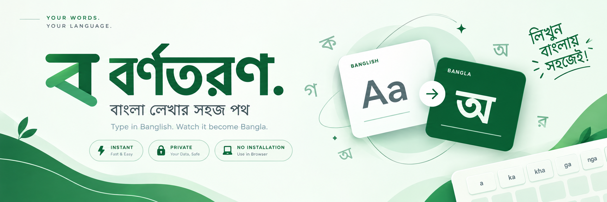

<div align="center">

<p align="center">
  
</p>

# Bornotoron · [বর্ণতরণ]()

### বাংলা লেখার সহজ পথ

Type in Banglish. Watch it become Bangla.


**1700+ spelling entries. Zero frameworks. Your words stay yours.**

</div>


## 📌 Table of Contents

- [📑 Overview](#overview)
- [💡 Why Bornotoron?](#why-bornotoron)
- [✨ Key Features](#key-features)
- [🛠️ Built With](#built-with)
- [🌗 Theming & Brand](#theming)
- [🚀 Getting Started](#getting-started)
- [📁 Project Structure](#project-structure)
- [🧠 How the Engine Works](#engine)
- [⌨️ Phonetic Quick Reference](#phonetic-reference)
- [💾 Privacy & Local Storage](#local-storage)
- [🧪 Tests & Accessibility](#tests)
- [🌐 Routes & Deployment](#deployment)
- [🗺️ Known Limits & Next Steps](#roadmap)
- [🤝🏼 Contributing](#contributing)
- [📜 License](#license)
- [⭐ Support](#support)


<a id="overview"></a>
## 📑 Overview

**Bornotoron** is a static, framework-free Banglish-to-Bangla phonetic writing tool. Write the way you speak, and receive Bangla Unicode in real time:

```text
Ami banglay likhchi    →  আমি বাংলায় লিখছি
shubho shokal          →  শুভ সকাল
amar bon bhalo ache    →  আমার বন ভালো আছে
                                 ↳ Choose বোন if you mean “Sister”
```

**বর্ণ** means letter. **তরণ** means crossing. Bornotoron is a small bridge between the way you type and the script you love.

It combines phonetic rules, a bundled spelling dictionary, explicit homophone choices, and your own learned corrections. This is an **independent Avro-inspired implementation**, not the official Avro engine or a translation service.


<a id="why-bornotoron"></a>
## 💡 Why Bornotoron?

| | A basic transliteration box | Bornotoron |
|---|---|---|
| **Spelling** | One phonetic rule for everything | Dictionary-first spelling with greedy-rule fallback |
| **Ambiguity** | Silently chooses one spelling | Dotted words offer genuine alternatives |
| **Your preferences** | Correct the same word repeatedly | Explicitly remember your own spellings |
| **Workflow** | Type, submit, wait | Live conversion, copy, download, and restore |
| **Privacy** | May send text to a service | All conversion and personal data stay in your browser |
| **Design** | Fixed theme or cramped controls | Silver-water light theme, neutral dark theme, mobile navigation |
| **Setup** | Install a keyboard or app | Open `index.html` – no installation or build step |


<a id="key-features"></a>
## ✨ Key Features

### ✍️ Write naturally

- ⚡ **Live conversion** – Updates as you type, with no submit button.
- 📚 **1700+ spelling entries** – Frequent words, inflections, and common Banglish aliases; around 1200+ differ from the raw phonetic fallback.
- 🔀 **16 ambiguity groups** – Including `bon → বন / বোন`, `bhor → ভর / ভোর` and so on.
- 🧠 **Learned corrections** – Click an output word, edit its Bangla spelling, and choose whether to remember it.
- 🔢 **Bangla digits** – Optional `0123456789 → ০১২৩৪৫৬৭৮৯`, with a saved preference.
- 🧩 **Unicode support** – Vowels, kar, aspirates, conjuncts, diacritics, and preserved whitespace, punctuation, existing Bangla, and emoji.

### 🧰 Keep your flow

- 📋 **Copy** – Success animation and `Ctrl/Cmd + Enter` from the input; fallback when clipboard permission is unavailable.
- 📄 **Download** – Browser-generated UTF-8 `.txt` output. No server endpoint.
- 🧹 **Clear** – Reset the current input without deleting your saved history.
- 💾 **History & drafts** – Restore the last 10 conversions and recover your draft on reload.
- 📊 **Live counts** – Grapheme-aware character counts where supported, plus word counts.
- 📖 **Phonetic guide** – Collapsible, keyboard-navigable reference tabs.

### 🎨 A considered interface

- 🌗 **Two complete themes** – Forest green on silver-grey in light mode; GitHub-inspired near-black/slate with green text/icons in dark mode.
- 📱 **Responsive navigation** – A smooth animated hamburger contains নিয়ম, ইতিহাস, গিটহাব, and the theme switch on mobile.
- ♿ **Accessible controls** – Labels, visible focus, keyboard navigation, inert closed-menu content, Escape/outside-click dismissal, and reduced-motion support.
- 🌿 **User-supplied Bengali logo** – The original green mark, with its white background removed to real transparent PNG, for the navbar and favicon; plus a self-contained **1500 × 500 (3:1) SVG banner**.
- 🪡 **Subtle alpona-inspired texture** – SVG pattern, not a raster image.
- 🐛 **Local issue-report preparation** – Write a report and download it; no silent upload or false submission confirmation.


<a id="built-with"></a>
## 🛠️ Built With

| Layer | Technology |
|---|---|
| **Structure** | Semantic HTML5 and native dialogs |
| **Styling** | CSS custom properties, Grid, Flexbox, media queries |
| **Logic** | Vanilla JavaScript – classes, closures, event delegation |
| **Conversion** | Dictionary lookup, longest-match-first rules, incremental token reuse |
| **Persistence** | `localStorage` only |
| **Text measurement** | `Intl.Segmenter` with Unicode code-point fallback |
| **Export** | Clipboard API, Blob, object URLs |
| **Motion** | CSS transitions/keyframes and Intersection Observer |
| **Typography** | Optional Google Fonts: Inter and Hind Siliguri |
| **Brand assets** | Transparent PNG logo/favicon; SVG banner and UI icons |
| **Testing** | Framework-free browser regression runner |

**No React, Vue, Tailwind, Bootstrap, npm, bundler, backend, database, API key, or analytics.**


<a id="theming"></a>
## 🌗 Theming & Brand

The active theme is read **before first paint**, defaults to `prefers-color-scheme`, and is saved after an explicit choice. Switching themes crossfades over roughly 300 ms. The icon displays the current state: **sun in light mode, moon in dark mode**; its accessible label describes the switch action. Reduced-motion preferences are respected. Footer copyright and links use a more readable 12px size.

| Token / role | Light | Dark |
|---|---|---|
| **Page background** | `#EDF0F2` – cool silver-water | `#0D1117` – GitHub-inspired near-black |
| **Surface** | `#FAFCFD` | `#161B22` |
| **Output / secondary surface** | `#E6ECEE` | `#161B22` |
| **Primary accent** | **`#236340`** | **`#47BE7A`** |
| **Text** | `#202629` | `#E6EDF3` |
| **Muted text** | `#59646B` | `#A7B0BA` |
| **Primary button fill** | `#236340` | `#21262D` |

Dark-mode cards, dialogs, hover fills, and button backgrounds use **GitHub-inspired near-black and slate**, not green-tinted surfaces. The green remains in typography, icons, and small interaction indicators.

The editor arrow occupies its own grid column on desktop and its own row on mobile, with clearance on both sides. It remains separated from the cards even after resizing the input. The default example is **“Ami banglay likhchi” → “আমি বাংলায় লিখছি”**, under **“মনের কথা, বাংলার অক্ষরে”**. Existing user drafts are preserved; the new default appears when no saved draft exists.

### Brand files

- **Banner:** [`Assets/Banner/Bornotoron_Banner_3.png`](Assets/Banner/Bornotoron_Banner_3.png), exactly 3:1.
- **Logo:** [`Assets/Logo/logo.png`](Assets/Logo/logo.png) – background-removed PNG derived from the user's original artwork, not redrawn.
- **Favicon:** [`Assets/Logo/logo.png`](Assets/Logo/logo.png) – the same transparent mark, also used as the touch icon.
- **Pattern:** tileable SVG data URI in `style.css`.

The header logo frame is **32px on desktop / 30px on mobile**, balanced against the Bangla wordmark. Its container has **no white fill**, and the PNG has genuine alpha transparency, including its inner triangular cutout. CSS only crops surplus transparent margins; it does not redraw the mark. The favicon retains the source artwork's transparent outer margin.

The obsolete bridge logo has been removed from the banner. The banner is an editable typographic vector illustration, with no embedded raster images or external asset requests. Text uses system-font fallbacks, so its exact letterforms can vary by viewer. The application does not load the README banner at runtime.


<a id="getting-started"></a>
## 🚀 Getting Started

### Prerequisites

A current Chrome, Edge, Firefox, or Safari browser. That's it.

### Open locally

```bash
git clone https://github.com/TajkirHossen-14/Bornotoron.git
cd Bornotoron
```

1. Download/clone the repository, retaining the directory structure.
2. Open **`index.html`**.
3. Type, choose a suggestion, or try an example chip.

Unlike an ES-module application, Bornotoron uses ordered classic `defer` scripts and works directly over **`file://`**. Conversion requires no internet connection. Google Fonts is optional; installed system fonts provide a fallback.

### Optional local server

A static server provides a stable browser storage origin and enables the full iframe integration suite:

```bash
# From the project root, if Python is already installed:
python3 -m http.server 8000
```

Then open `http://localhost:8000`. This is optional static-file serving, not an application backend.

> Local file storage and clipboard permissions vary by browser. For predictable persistence and deployment behavior, use a static HTTP/HTTPS origin.


<a id="project-structure"></a>
## 📁 Project Structure

```text
Bornotoron/
│
├── index.html              # App, image logo/favicon links, dialogs
│
├── style.css               # Themes, responsive layout, motion
│
├── js/
│   ├── main.js             # UI, menu, local persistence and exports
│   ├── rules.js            # Phonetic and boundary-rule data
│   ├── dictionary.js       # Overrides, homophones, regression data
│   ├── transliterate.js    # Pure conversion engine
│   └── tests.js            # Engine/UI/contrast regression suite
│
├── Assets/
│   ├── Logo/      
│   ├── Favicon/    
│   └── Banner/        
│
├── tests.html 
│
├── LICENSE
└── README.md
```

Redundant quick-start/asset-only README files and temporary dark-mode/navigation preview helpers have been removed. Only application files, required brand assets, the preserved source artwork, this documentation, and the regression runner remain.


<a id="engine"></a>
## 🧠 How the Engine Works

### Dictionary-first resolution

Every Latin word follows this order:

```text
Personal spelling → Built-in override → Homophone preview → Phonetic fallback
```

Dictionary lookups are case-insensitive; phonetic patterns retain meaningful case (`o` and `O` differ). Homophone previews keep their alternatives available, rather than pretending to infer sentence context.

`doNotOverride` is test data, **not another hidden override layer**. The original 14 regression words remain protected. Some everyday dictionary aliases deliberately agree with the fallback; all protected regression keys stay outside overrides.

### Longest-match-first phonetics

Patterns are sorted by length once: `chh` wins over `ch`, and `kh` wins over `k`. A pending-consonant state chooses an independent vowel or attached kar; consonant collisions normally insert হসন্ত (`্`).

Lowercase `o` consumes the inherent vowel without inserting `ো`. Uppercase `O` explicitly adds it. A small data-driven verb-boundary rule handles future forms such as `kor + bo → করব` without breaking genuine conjuncts such as `sorbo → সর্ব`.

The text tokenizer preserves separators, including periods and decimal points. Although the standalone phonetic helper contains a period-to-dari mapping, punctuation is not converted in the full editor.

### Incremental updates

- Memoized resolution avoids converting unchanged words again.
- Common prefix/suffix tokens retain their IDs and occurrence-specific corrections.
- DOM reconciliation replaces the changed token range rather than the whole output.
- `requestAnimationFrame` batches live UI updates; composition events respect IME input.
- Tokenization and counters still scan the text: this is **not** a claim of sublinear total work for every edit.
- Animation operates on Bangla shaping runs/words, not isolated combining characters, preserving conjunct shaping.

### Engine API

```javascript
const engine = new BornotoronEngine({ bon: 'বোন' });
const tokens = engine.convert('ami banglay likhchi. 2026', true);
console.log(engine.text()); // আমি বাংলায় লিখছি. ২০২৬

const word = tokens.find(token => token.isWord);
engine.choose(word.id, 'আমিই');  // One occurrence only
engine.setPersonal({ bon: 'বোন' }); // Replace preferences and clear caches
```

### JavaScript concepts worth a look

- **Classes & closures** – Pure conversion state isolated from the DOM.
- **Maps & memoization** – Cached phonetic/dictionary results.
- **Greedy matching** – Longest patterns resolve first.
- **Stable token identity** – Preserve edits through unchanged suffixes.
- **Event delegation** – Dynamic word controls and mobile navigation.
- **Debouncing** – History saves after a pause instead of on every keystroke.
- **Async/await** – Clipboard handling with explicit failure fallback.
- **Blob lifecycle** – Browser-only downloads and delayed URL revocation.
- **MediaQueryList** – Theme and navigation respond to system/viewport changes.
- **WCAG relative luminance** – Numerical contrast verification, not visual guesswork.


<a id="phonetic-reference"></a>
## ⌨️ Phonetic Quick Reference

| Input | Bangla / behavior |
|---|---|
| `o`, `O` | অ, ও |
| `ko`, `kO` | ক, কো |
| `a / aa`, `i`, `I / ee`, `u`, `U` | আ, ই, ঈ, উ, ঊ; kar after consonants |
| `e`, `oi`, `ou`, `rri` | এ, ঐ, ঔ, ঋ |
| `c`, `ch / chh` | চ, ছ |
| `kh`, `gh`, `jh`, `th`, `dh`, `ph`, `bh` | খ, ঘ, ঝ, থ, ধ, ফ, ভ |
| `T / Th`, `D / Dh`, `N` | ট / ঠ, ড / ঢ, ণ |
| `sh`, `Sh / S` | শ, ষ |
| `R / rr`, `Rh / rh` | ড়, ঢ় |
| `Ng / NG`, `NY / ny`, `ng` | ঙ, ঞ, ং |
| `H`, `^` | ঃ, ঁ |
| `y` | য় normally; য-ফলা after a pending consonant |
| `kkh / kSh / ksh`, `gg` | ক্ষ, জ্ঞ |
| Backtick | Explicit হসন্ত; `t` followed by backtick gives ৎ |
| `0123456789` | ০১২৩৪৫৬৭৮৯ with Bangla digits enabled |

Click any output word to correct it. The output is read-only by default; word-level editing happens in the suggestion popover.


<a id="local-storage"></a>
## 💾 Privacy & Local Storage

No text is sent to a transliteration API. There is no server-side persistence, Table API, D1 database, analytics, or cross-device sync.

| Key | Structure |
|---|---|
| `bornotoron.theme` | Raw `light` / `dark` string |
| `bornotoron.digits` | JSON boolean |
| `bornotoron.personal` | `{ lowercaseBanglish: banglaSpelling }` |
| `bornotoron.draft` | `{ input, choices: [{ index, raw, text }] }` |
| `bornotoron.history` | Up to 10 `{ input, output, choices, digits, time }` records |

- History saves after **1.8 seconds** of inactivity and on copy/download. The untouched demo is not saved on initial load.
- Exact word snapshots restore earlier choices even after learned preferences change.
- Identical conversions are deduplicated. Text over **50,000 input characters** is editable/exportable but excluded from history to bound storage use; draft storage is still attempted.
- Personal corrections are limited to 100 characters each; initialization accepts up to 3,000 valid learned entries.
- Storage errors do not break conversion. Private mode, browser quota, and file origins may prevent persistence.
- Local data is **not encrypted**. Use **Privacy & Local Data** to clear history, forget corrections, or delete all app data after confirmation.
- Issue reports contain only the description you type and a timestamp. They are downloaded locally, **not submitted**.

**External resources:** the app optionally requests Google Fonts from `fonts.googleapis.com` and `fonts.gstatic.com`. README badges separately use Shields.io; they are not part of the application. Font requests do not contain your editor text.


<a id="tests"></a>
## 🧪 Tests & Accessibility

Open **`tests.html`** to run the browser suite. 

### What's covered

- Dictionary entries, case behavior, homophones, and protected fallback regressions.
- Vowels, kar, aspirates, conjuncts, special signs, digits, whitespace, emoji, and existing Bangla.
- Override precedence, cache invalidation, stable token IDs and a **57,500-character** conversion plus append.
- Real UI typing, word choices, learned spellings, history, guide tabs, copy state, download contents and reload persistence.
- Exact light accent, GitHub-dark card/button colors, theme icons, footer/title content.
- PNG alpha checks for transparent outer background and inner cutout, retained artwork, no white logo tile, and the revised interface copy.
- Arrow clearance on desktop, mobile, and after resizing the input; the new default sentence.
- Hamburger open/close, inert closed content, theme switch inside the menu, Escape focus restoration, outside press, link selection, and desktop breakpoint recovery.
- Issue dialog and local report download without editor text leakage.

Clipboard transport is stubbed for the automated UI check. Real permissions, the fallback copy path, native downloads, and assistive technology still deserve testing on supported devices.

> **Run tests with other Bornotoron tabs closed.** The runner temporarily backs up the five storage keys, tests against clean values, and restores your data. Let it finish. On `file://`, engine/contrast checks run but same-origin iframe UI tests are skipped.

Visual QA checked the **real page** at desktop (1280px) and phone (390px) widths in both themes, including the arrow's clearance from the editor cards. Hamburger opening, keyboard behavior, link selection, and responsive state are covered by the real-UI regression suite. Temporary preview helpers were removed after review.

### Verified contrast pairs

| Pair | Contrast |
|---|---:|
| `#236340` / silver background | **6.26:1** |
| `#236340` / output panel | **6.01:1** |
| `#236340` / light surface | **6.96:1** |
| White / primary green button | **7.17:1** |
| Light muted text / output panel | **5.09:1** |
| Dark accent / dark card | **7.34:1** |
| Dark muted text / dark card | **7.88:1** |
| Dark accent / neutral button | **6.46:1** |

All listed pairs meet WCAG AA for normal text. This is not a claim of a third-party accessibility certification.

---

<a id="deployment"></a>
## 🌐 Routes & Deployment

### Functional entry points

| Path | Function |
|---|---|
| `/` or `/index.html` | Main app; no query parameters required |
| `/index.html#writing-workspace` | Editor |
| `/index.html#cheat-sheet` | Opens the guide |
| `/index.html#recent-history` | Opens history |
| `/index.html#navigation` | Opens the hamburger at mobile widths |
| `/tests.html` | Regression suite and banner preview |
| `/Assets/Banner/Bornotoron_Banner_3.png` | Standalone 3:1 PNG banner |
| `/Assets/Logo/logo.png` | Transparent brand logo |
| `/Assets/Favicon/favicon.png` | Transparent favicon / touch icon |

Privacy, About, and Report an Issue are in-page dialogs. Navbar, mobile-menu, footer, and About GitHub links open the actual repository in a new tab with `noopener noreferrer`. The report dialog links to GitHub's new-issue page and also offers an optional local report download. Submission happens on GitHub, not silently inside this app.

### Public URLs

- **Production:** No deployment URL has been assigned in this project yet.
- **GitHub repository:** https://github.com/TajkirHossen-14/Bornotoron
- **Issue tracker:** https://github.com/TajkirHossen-14/Bornotoron/issues
- **New issue:** https://github.com/TajkirHossen-14/Bornotoron/issues/new (GitHub sign-in and repository permissions may apply).
- **Application API endpoints:** None.

### Static hosting

| Platform | Configuration |
|---|---|
| **GitHub Pages** | Deployment branch, source `/ (root)` |
| **Netlify** | No build command; publish directory `.` |
| **Vercel** | Static/Other preset, no build command; output directory `.` |

Relative paths support repository subdirectories. No rewrite rules are needed. The app needs `index.html`, `style.css`, its four primary JavaScript files, and the PNG files in `Assets/Logo/` and `Assets/Favicon/`.  The regression runner (`tests.html` and `js/tests.js`) may be excluded from a production upload.


<a id="roadmap"></a>
## 🗺️ Known Limits & Next Steps

### Not implemented / intentionally limited

- Full official Avro compatibility or a complete linguistic dictionary.
- Automatic contextual disambiguation, AI translation, reverse transliteration, or speech input.
- Rich-text output editing; corrections are word-level.
- Cloud accounts, collaboration, encrypted local data, or cross-device sync.
- PWA installation, a service worker, or bundled webfonts. The downloaded files convert offline, but reopening a hosted site offline is not guaranteed.
- In-app authenticated issue submission or an assigned production URL. Repository and issue-page links are connected; submission is handled by GitHub.
- Legacy browser support for engines without modern JavaScript, native dialogs, or `inert`.

### Recommended development

1. Review spellings and ambiguities with a native Bangla editor; automated consistency tests are not independent linguistic proof.
2. Expand tested contextual rules and inflection coverage.
3. Test clipboard, downloads, IME input and screen readers across the supported browser/device matrix.
4. Publish the static app, document its production URL, and confirm the repository's Issues feature is enabled.
5. Add versioned learned-dictionary import/export and storage migrations if needed.
6. Consider licensed local fonts and a tested service worker only if installable offline use becomes a requirement.


<a id="contributing"></a>
## 🤝🏼 Contributing

Have a better spelling, a reproducible bug, or an accessibility improvement?

1. Run the regression suite before making changes.
2. Keep spelling data in `dictionary.js` and phonetic data in `rules.js`.
3. Add regression cases for new behavior; never silently override a protected default word.
4. Keep dark surfaces free of green tint and verify both themes at mobile and desktop widths.
5. Include a short explanation and test results when sharing a proposed patch with the maintainer.

Visit the [repository](https://github.com/TajkirHossen-14/Bornotoron) to propose a patch, or [open an issue](https://github.com/TajkirHossen-14/Bornotoron/issues/new) with reproduction steps. The footer's **Report an Issue** dialog also offers a local report download; the app itself does not upload your data.


<a id="license"></a>
## 📜 License

This project is licensed under the [MIT License](LICENSE).


<a id="support"></a>
## ⭐ Support

If Bornotoron helps you write more naturally, share it, send useful spelling or usability feedback, and consider giving the [repository](https://github.com/TajkirHossen-14/Bornotoron) a star ⭐.

<div align="center">

**এক ভাষা থেকে আরেক ভাষায়, একটু সহজে।**

</div>
